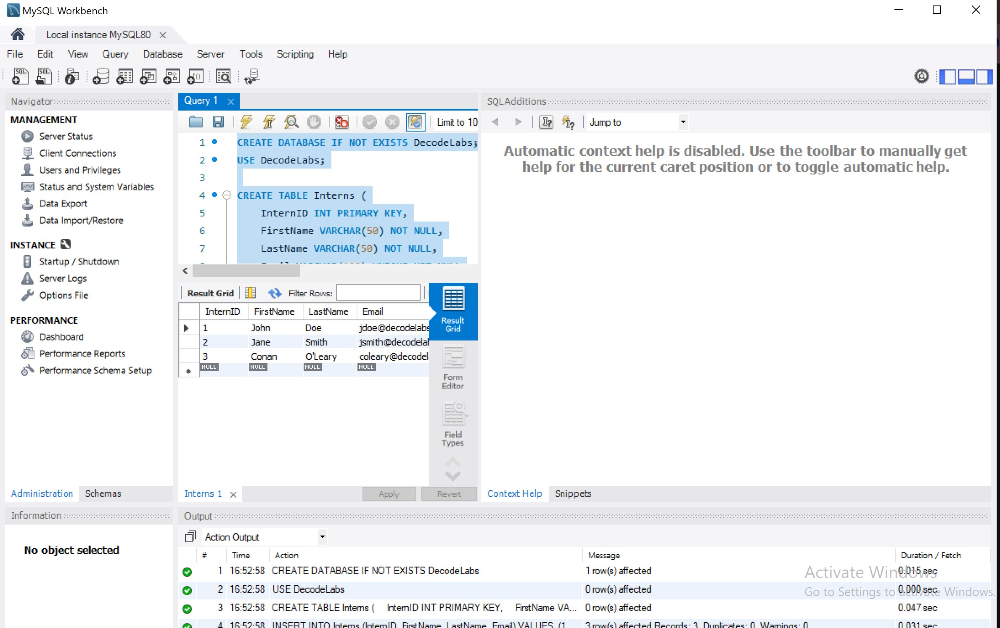
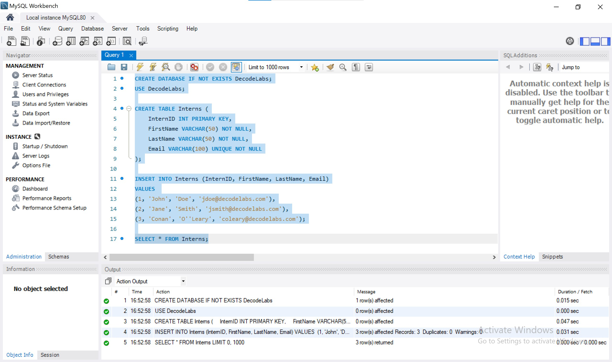

# DecodeLabs Cloud Computing — Project 3: MySQL Database Setup & Population

## 📌 Project Overview
This repository contains the implementation for **Project 3** of the DecodeLabs Cloud Computing Internship. The project demonstrates creating a local MySQL database, defining the schema for an `Interns` table, inserting intern records, and querying the database using **MySQL Workbench**.

---

## 🛠️ Technologies Used
* **Database Engine:** MySQL Server 8.0
* **Database Management Tool:** MySQL Workbench
* **Language:** SQL

---
### 1. MySQL Workbench Setup


### 2. Query Execution Result Grid


---
## 📄 SQL Script (`script.sql`)

```sql
-- Create Database
CREATE DATABASE IF NOT EXISTS DecodeLabs;
USE DecodeLabs;

-- Create Schema
CREATE TABLE Interns (
    InternID INT PRIMARY KEY,
    FirstName VARCHAR(50) NOT NULL,
    LastName VARCHAR(50) NOT NULL,
    Email VARCHAR(100) UNIQUE NOT NULL
);

-- Populate Data
INSERT INTO Interns (InternID, FirstName, LastName, Email)
VALUES 
(1, 'John', 'Doe', 'jdoe@decodelabs.com'),
(2, 'Jane', 'Smith', 'jsmith@decodelabs.com'),
(3, 'Conan', 'O''Leary', 'coleary@decodelabs.com');

-- Retrieve Data
SELECT * FROM Interns;
